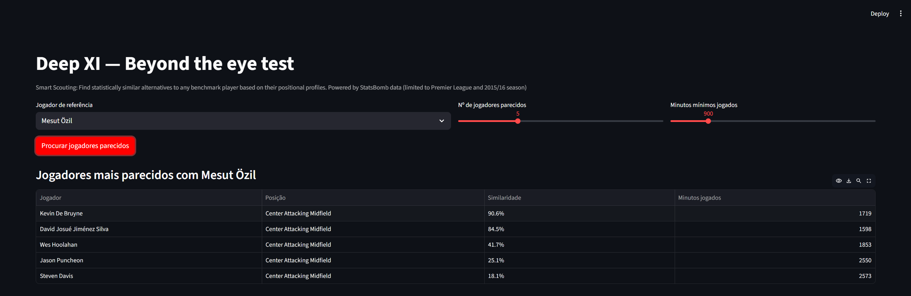

# Deep XI: Player Similarity Engine

*Beyond the eye test.* A prototype for data-driven football scouting. Given a reference player, it finds statistically similar alternatives within the same positional group, the foundation for "find the next [player], but cheaper".


                                                                                        
## Example

Top 5 players most similar to **Mesut Özil** (Premier League 2015/16, minimum 900 minutes played):

| Player | Position | Similarity | Minutes |
|---|---|---|---|
| Kevin De Bruyne | Center Attacking Midfield | 90.6% | 1719 |
| David Josué Jiménez Silva | Center Attacking Midfield | 84.5% | 1598 |
| Wes Hoolahan | Center Attacking Midfield | 41.7% | 1853 |
| Jason Puncheon | Center Attacking Midfield | 25.1% | 2550 |
| Steven Davis | Center Attacking Midfield | 18.1% | 2573 |

Sanity check: the two closest matches are Kevin De Bruyne and David Silva, both elite creative attacking midfielders, which is what a scout would expect. Similarity drops quickly after that because few players share this profile.

## How it works

1. **Data**: match events are downloaded from [StatsBomb Open Data](https://github.com/statsbomb/open-data) and cached locally.
2. **Feature engineering**: events are turned into per-90-minute statistics for each player.
3. **Positional groups**: players are only compared with others in the same group, each with its own set of relevant metrics (defined in `src/config.py`).
4. **Similarity**: metrics are standardised with z-scores inside each group, then players are ranked by cosine similarity to the reference player.
5. **Minutes filter**: players below a minimum-minutes threshold are excluded to avoid comparisons based on tiny samples. Because the normalisation is computed on the remaining players, the threshold can change the scores slightly.

## Project structure

```
ai-scouting/
├── data/                       # raw and processed data (local cache, not tracked by git)
├── src/
│   ├── config.py               # positional groups and metrics per group
│   ├── data_loader.py          # downloads and caches StatsBomb Open Data events
│   ├── feature_engineering.py  # turns events into per-player, per-90 stats
│   └── similarity.py           # similarity engine (z-score + cosine similarity)
├── app/
│   └── app.py                  # interactive Streamlit app
├── docs/
│   └── app.png                 # app screenshot
├── requirements.txt
└── README.md
```

## Quick start

```bash
# 1. install dependencies
pip install -r requirements.txt

# 2. download data (StatsBomb Open Data, Premier League 2015/16, full season)
python src/data_loader.py --competition_id 2 --season_id 27 --out data/raw_events_pl1516.parquet

# 3. build the per-player stats table
python src/feature_engineering.py --events data/raw_events_pl1516.parquet --out data/player_stats_pl1516.parquet

# 4. run the app
streamlit run app/app.py
```

You can also query the similarity engine directly from the command line:

```bash
python src/similarity.py --stats data/player_stats_pl1516.parquet --player "Mesut Özil" --top_n 5
```

## Why Premier League 2015/16?

StatsBomb released full-season coverage (all matches, all teams) for the 2015/16 season of the "Big 5" European leagues, which makes it one of the best free datasets for this kind of work. The Premier League gives 380 matches across all 20 teams, so player minutes are reliable at every position. Most other open datasets only cover selected matches or teams.

To use another league or season, change `competition_id` / `season_id`. Use `statsbombpy.sb.competitions()` to list the available options.

## Current limitations

- **Open event data, not tracking data.** Metrics such as real xA, progressive carries and passes into the box need positional (tracking) data, which only comes from paid providers (e.g. Wyscout, Opta, InStat) or club partnerships. These are currently placeholders (always 0) and do not influence the results.
- **League coverage.** There is no open data for leagues like the Portuguese Liga or lower divisions. This prototype demonstrates the concept on a top league. With access to a paid provider's API, the same pipeline can be applied to the relevant leagues.
- **Season relevance.** 2015/16 data is for demonstration; results say nothing about current player quality.
- **Minimum minutes.** Players with few minutes are filtered out to keep per-90 statistics meaningful.

## Next steps

- Add age and estimated market value filters (e.g. from Transfermarkt).
- Move beyond cosine similarity: PCA + clustering, or learned embeddings.
- Export a per-player PDF report.
- Plug in a paid data source when budget or a partnership allows.

## Data and attribution

Data: [StatsBomb Open Data](https://github.com/statsbomb/open-data). If you publish anything built on it, credit StatsBomb as the data source and follow their [user agreement](https://github.com/statsbomb/open-data).
